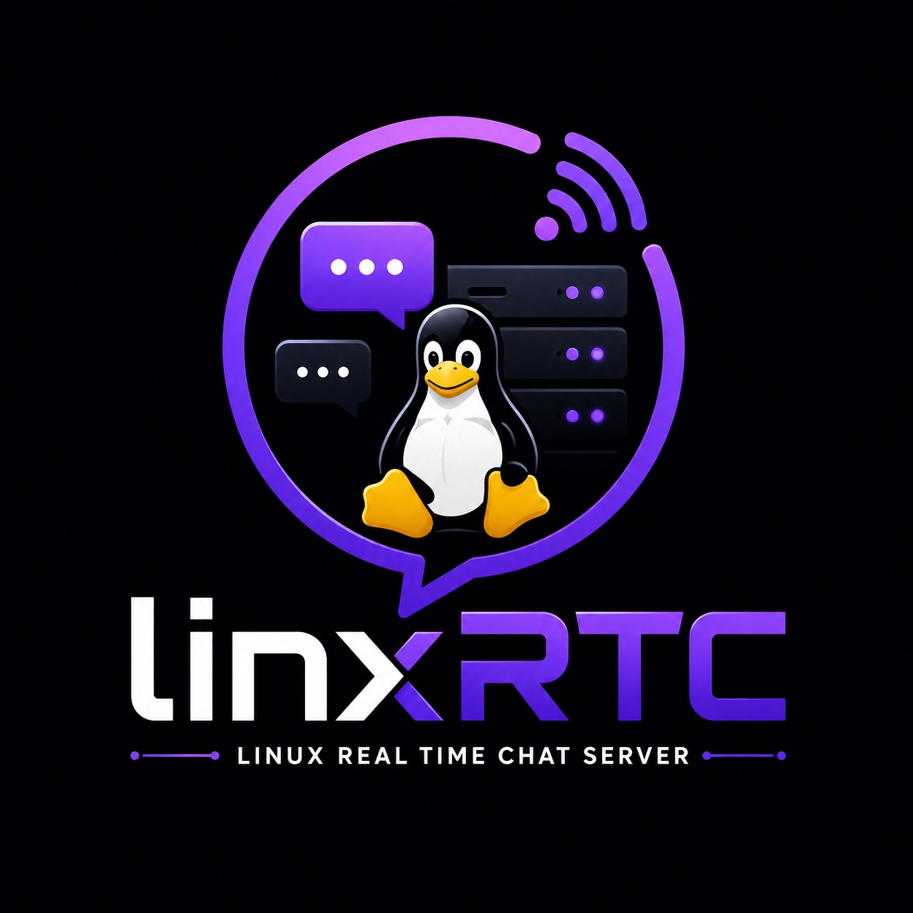

<p align="center">

  
</p>

<h1 align="center">LinXRtc</h1>

<p align="center">
  <b>A modular Linux Real Time Chat Server  </b>
</p>

<p align="center">
  Fast • Multithreaded • Group chat • single chat
</p>

---
A multi-client real-time communication server built with Python sockets, handling encrypted peer messaging, concurrent client connections, and message dispatch.

---

## Prerequisites

* **Operating System:** Linux, macOS, or Windows
* **Python Version:** Python 3.10 or higher
* **Package Manager:** `pip`

---

## Installation Process

### 1. Clone the Repository

```bash
https://github.com/7h3-h4k3r/linXRtc
cd linxRtc

```

### 2. Create and Activate a Virtual Environment

```bash
# Create virtual environment
python3 -m venv venv

# Activate on Linux / macOS
source venv/bin/activate

# Activate on Windows (Command Prompt)
# venv\Scripts\activate.bat

# Activate on Windows (PowerShell)
# .\venv\Scripts\Activate.ps1

```
### 2. Create a .env file to save your Database Details

```bash
MONGO_DB='RTC_USERS'
MONGO_URI='mongodb://localhost:27017'

```

### 3. Install Dependencies

Install the required cryptographic, networking, and UI dependencies:

```bash
pip install -r requirements.txt

```
---

## Start Process

### 1. Start the Server

Launch the dedicated server daemon to begin listening for inbound client socket connections:

```bash
python3 server.py

```

By default, the server binds to `0.0.0.0` on the configured listening port (e.g., `7878`).

```text

[+] Listening on 0.0.0.0:7878
[+] Waiting for incoming connections...

```
